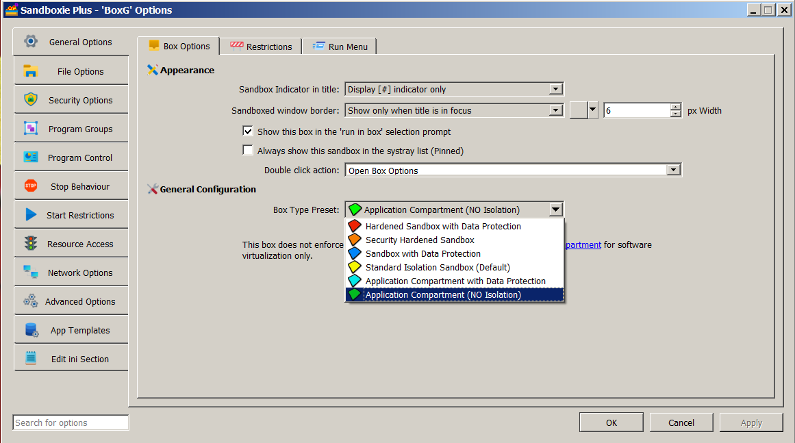

# アプリケーション コンパートメント

> [!NOTE]
> この機能には[サポート証明書](https://sandboxie-plus.com/supporter-certificate/)が必要です。

アプリケーション コンパートメントは Sandboxie Plus 1.0.0 で導入されました。標準サンドボックスで使用されるいくつかのセキュリティ分離メカニズムを迂回しつつ、選択された Sandboxie の仮想化およびポリシー メカニズムを保持することで、アプリケーションの互換性を優先します。

> [!WARNING]
> アプリケーション コンパートメントは分離を実質的に低下させるため、互換性要件のある信頼されたアプリケーションにのみ使用してください。Sandboxie なしで実行するのと同等ではありませんが、ファイルとレジストリの仮想化だけをセキュリティ境界として扱うべきではありません。

## 構成

主要なボックス設定は次のとおりです。

```ini
[DefaultBox]
NoSecurityIsolation=y
```

SandMan では、**Sandbox Options > General Options** で **Application Compartment** ボックス タイプを選択します。新しいボックス ウィザードでは、対応するプリセットを **Application Compartment Box** と呼びます。ステータス列は通常、結果のボックスを **Application Compartment** として識別します。

構成がリソース ルート全体を開く場合、たとえば `OpenFilePath=*` の場合、SandMan は代わりに **OPEN Root Access** を表示します。このステータス警告は表示上 **Application Compartment** より優先されます。構成されたボックス タイプを変更したり、`NoSecurityIsolation` を無効にしたりするものではありません。

基になる詳細設定は **Sandbox Options > Security Options > Security Isolation** にあり、**Disable Security Isolation** と表示されます。



## セキュリティと互換性のモデル

アプリケーション コンパートメントは、Sandboxie の通常の制限付きプライマリ トークン置換と通常の偽装トークン フィルタリング パスを迂回します。また、プロセスを Sandboxie の通常のルート Job Object 割り当てから除外し、いくつかのセキュリティ指向のパス ポリシー既定を緩和します。

アプリケーション コンパートメントはそれ自体でプロセスを昇格させません。代わりに、Sandboxie の通常の制限付きトークン置換を迂回するため、プロセスは起動されたときのセキュリティ コンテキストを保持できます。昇格されていないプロセスは昇格されないままであり、意図的に昇格して起動されたプロセスはその昇格されたコンテキストを保持できます。

ファイルシステムとレジストリの仮想化はアクティブなままにできます。ファイル、レジストリ キー、およびカーネル オブジェクトのドライバー フィルタリングも別個のままであり、アプリケーション コンパートメントを選択するだけでは無効になりません。構成されたリソース、ネットワーク、IPC、および GUI ルールは引き続き適用できます。

詳細な動作と制限については、[セキュリティ分離なし](../Content/NoSecurityIsolation.md)を参照してください。

## AppContainer トークンの動作

アプリケーション コンパートメントは、標準サンドボックスの `CreateAppContainerToken` および `CreateAppContainerProfile` 互換フックをインストールせず、その標準ボックス分岐を通じて AppContainer プロセス作成属性を抑制しません。このモードでは `DropAppContainerToken` は既定で `n` です。明示的に有効にすると、Sandboxie の通常の制限付きプライマリ トークン置換が迂回されている間、呼び出し元が提供した AppContainer トークン制限を削除する可能性があり、昇格を付与することなくトークン分離を弱めます。

歴史的な `FakeAppContainerToken` 設定は現在のコンパートメント動作を制御しません。別個の API および子作成段階については、[AppContainer トークンの互換性](../Content/AppContainerTokens.md)を参照してください。

## 省略可能なフィルタリングの緩和

追加の互換性のために、アプリケーション コンパートメントは次を使用できます。

```ini
NoSecurityFiltering=y
```

この設定は、アプリケーション コンパートメントがアクティブな間、Sandboxie のドライバー レベルのファイル、レジストリ キー、およびカーネル オブジェクト フィルターを無効にします。すべての Sandboxie フック、サービス、ルール、または仮想化メカニズムを文字通り無効にするわけではありません。[セキュリティ フィルタリングなし](../Content/NoSecurityFiltering.md)を参照してください。

SandMan では、チェックボックス **Disable Security Filtering (not recommended)** が同じ **Security Isolation** ページに表示され、**Disable Security Isolation** が選択されている場合にのみ有効になります。

## パスと名前空間の処理 {#path-and-namespace-handling}

Sandboxie は、アプリケーション コンパートメント プロセス用の組み込み `TemplateAppCPaths` ルールを読み込みます。Sandboxie Plus 1.8.0 以降、このモードの組み込みパス ルールはその専用テンプレートで維持されます。これらのルールはボックス タイプ固有のパス ポリシーを提供しますが、すべてのリソース分離を無効にするわけではありません。

通常の NT ディレクトリ オブジェクト名前空間分離は別個の設定のままです。高度なアプリケーション コンパートメント構成では、代わりに `UseAlternateIpcNaming=y` を使用できます。これは、通常の別個のディレクトリ オブジェクト名前空間を使用するのではなく、Sandboxie によってリダイレクトされた名前付きカーネル オブジェクトにサンドボックス固有の名前サフィックスを付与します。これはすべての IPC メカニズムの名前を変更するわけではありません。[NT 名前空間分離](../Content/NtNamespaceIsolation.md#alternate-ipc-naming)を参照してください。

## Job Object の制限

アプリケーション コンパートメント プロセスは、Sandboxie の通常のルート Job Object に割り当てられません。したがって、その Job Object を通じて実装されるボックス レベルのプロセス、メモリ、および CPU 制限は通常どおりには適用されません。[Job オブジェクト](../Content/JobObjects.md)を参照してください。

## バージョン履歴

- **Sandboxie Plus 1.0.0 / Classic 5.55.0:** `NoSecurityIsolation=y` によるアプリケーション コンパートメントを、省略可能な `NoSecurityFiltering` 互換設定と共に導入しました。
- **Sandboxie Plus 1.8.0:** 組み込みのアプリケーション コンパートメント アクセス ルールを `TemplateAppCPaths` に移動しました。
- **Sandboxie Plus 1.17.0 / Classic 5.72.0:** アプリケーション コンパートメント ボックスでの代替名前付きオブジェクト処理のために `UseAlternateIpcNaming` を追加しました。

## 関連ページ

- [セキュリティ分離なし](../Content/NoSecurityIsolation.md)
- [セキュリティ フィルタリングなし](../Content/NoSecurityFiltering.md)
- [NT 名前空間分離](../Content/NtNamespaceIsolation.md)
- [Job オブジェクト](../Content/JobObjects.md)
- [Sandboxie Ini](../Content/SandboxieIni.md)
