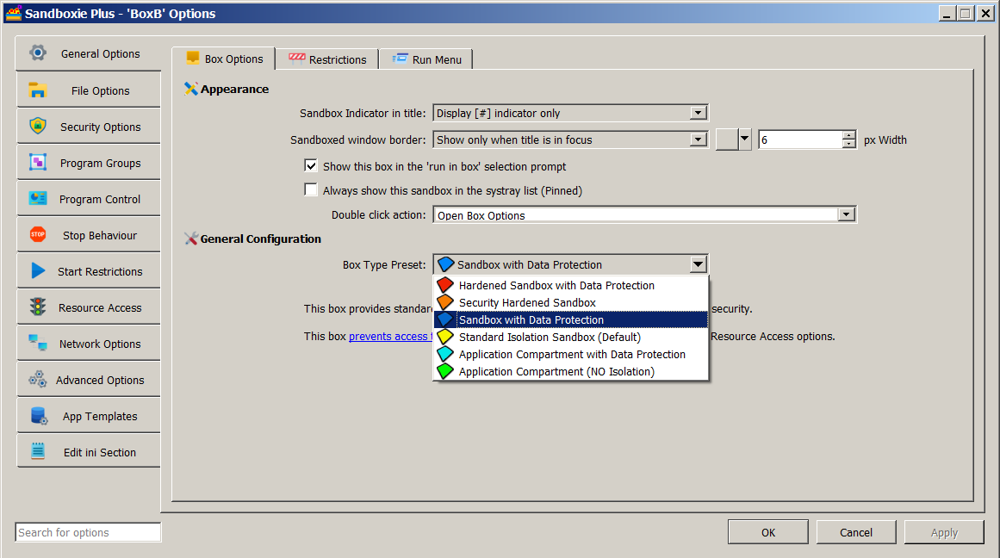

# プライバシー モード

**注: この機能には[サポート証明書](https://sandboxie-plus.com/supporter-certificate/)が必要です。**

プライバシー モードおよびプライバシー強化（またはデータ保護）ボックスの概念は **Sandboxie Plus v1.0.0** で導入されました。
このモードでは、PC 上のほとんどの場所が Write[File/Key]Path のように扱われるように設定されます。つまり、サンドボックス化された場所は書き込み可能ですが、サンドボックス外の場所は読み取り可能ではありません。
さらに、レジストリはユーザー ルート キーの読み取りを許可しません。言い換えれば、サンドボックス化されたプロセスは動作を続けることができますが、プライベートなユーザー データにアクセスすることはできません。

プライバシー強化ボックスの設定は、**[Sandboxie Ini](../Content/SandboxieIni.md)** のボックス設定セクションに `UsePrivacyMode=y` を追加することで有効にできます。Sandman UI でも有効にできます。ボックスを右クリックし、ドロップダウン メニューから「Sandbox Options」を選択するか（または単にボックスをダブルクリック）して、ボックス オプション UI を表示します。ボックス タイプ プリセットとして「Sandbox with Data Protection」（**ブルー**のボックス アイコン）を選択し、OK をクリックして変更を適用します。Sandman UI のステータス列では、このボックスは **Privacy Enhanced** と表示されます。

**ユーザー空間とは何ですか?** AppGuard は[ユーザー空間](https://malwaretips.com/threads/run-by-smartscreen-utility.65145/post-561364)を「通常、非管理者の Windows ユーザーがアクセスできるコンピューター ストレージ空間。これにはユーザーのプロファイル ディレクトリ（マイ ドキュメント フォルダーとデスクトップを含む）、リムーバブル ストレージ デバイス、ネットワーク共有、および追加の外部および内部ディスク ドライブなどのすべての非システム ハード ドライブが含まれる」と定義しています。「ユーザー空間」は、**システム**（コア オペレーティング システムとプログラムが存在する場所）の外側のすべて、言い換えれば `C:\Windows`、`C:\Program Files`、`C:\Program Files (x86)` フォルダーの外側のすべてと考えてください!

内部的には、プライバシー強化ボックスは 3 つの既定に基づいています。

1. **システム リソースへの読み取りアクセスを許可する:**

    - `C:\Windows`
    - `C:\Program Files`
    - `C:\Program Files (x86)`
    - `C:\ProgramData\Microsoft`（**Sandboxie Plus v1.12.7** 以降）
    - HKLM の下のレジストリ リソース（ただし HKCU ではない）は読み取り可能で、サンドボックス化できます。
    - **注:** 読み取りアクセスは、プライバシーと利便性の間で適切なバランスを提供します。もちろん、プライベート データを漏洩する可能性のある選択されたシステム リソースを特定し、必要に応じて（`Write[File/Key]Path` を使用して）さらに制限するために掘り下げることもできます。

2. **ユーザー空間を非表示にする（およびアクセスをブロックする）:**

    - ユーザー空間では、プライバシー ボックスは **既定でブロック** モードで動作します。すべてのドライブ パスが WriteFilePath に設定されます。これによりサンドボックス外のすべてのファイルとフォルダーが非表示になりますが、上書きルールによって特に許可されない限り、サンドボックス内に新しいファイルとフォルダーを作成できます。選択したパスへのアクセスは、[ルールの特異性](../PlusContent/RuleSpecificity.md)を呼び出すことで有効になります。

3. **[ルールの特異性](../PlusContent/RuleSpecificity.md)を有効にする:**

    - 内部的には、プライバシー モードではルールの特異性は **常に有効** です。**[Normal](../Content/NormalFilePath.md)** パス ディレクティブ（`Normal[File/Ipc/Key]Path`）を使用して、選択した場所を **読み取り可能かつサンドボックス化** するために開きます。パスを normal に設定することは、プライバシー モードで行われるように親パスが最初に何か他のものに設定されている場合にのみ意味があることに注意してください。したがって、これは **ブルー** ボックス（プライバシー モードに基づく）だけでなく、**レッド** ボックス（プライバシー モード **と** [セキュリティ モード](../PlusContent/security-mode.md)の両方が有効）にも関連します。

**最近の変更:** プライバシー モードの導入時に、いくつかの一般的なブラウザーとアプリケーション向けにいくつかの組み込みアクセス ルールが提供され、これらは後のバージョンで拡張されました。**Sandboxie Plus v1.8.0** 以降、すべての組み込みアクセス ルールは、管理を容易にするために一連の既定テンプレート（ファイル **Templates.ini** の `[TemplatePModPaths]` セクションに含まれる）に移動されました。
