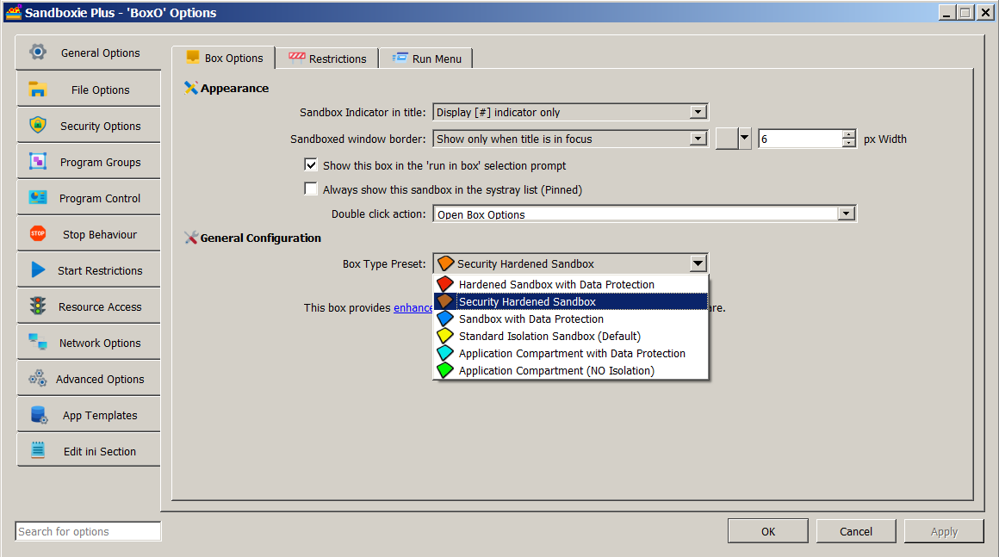

# セキュリティ強化モード

**注: この機能には[サポート証明書](https://sandboxie-plus.com/supporter-certificate/)が必要です。**

セキュリティ強化ボックスとセキュリティ強化モードの概念は **Sandboxie Plus v1.3.0** で導入されました。Sandboxie のシステムコール仲介内での元の/完全なトークン実行を、承認された NT および Win32k システムコールに制限します。また、デバイス アクセスを既知の安全/フィルター済みエンドポイントに制限することで、デバイスのセキュリティを提供します。

セキュリティ強化ボックスの設定は、**[Sandboxie Ini](../Content/SandboxieIni.md)** のボックス設定セクションに `UseSecurityMode=y` を追加することで有効にできます。Sandman UI でも有効にできます。ボックスを右クリックし、ドロップダウン メニューから「Sandbox Options」を選択するか（または単にボックスをダブルクリック）して、ボックス オプション UI を表示します。ボックス タイプ プリセットとして「Security Hardened Sandbox」（**オレンジ**のボックス アイコン）を選択し、OK をクリックして変更を適用します。Sandman UI のステータス列では、このボックスは **Enhanced Isolation** と表示されます。

実行時に、`UseSecurityMode=y` は 4 つの関連するセキュリティ動作を有効にします。これらの関係は、プリセットを有効にすると 4 つの別個の設定がサンドボックス構成に書き込まれるという意味ではありません。

1. **[DropAdminRights](../Content/DropAdminRights.md):** `UseSecurityMode=y` はトークン処理中に管理者権限を削除する動作を適用します。**Sandboxie Plus v1.3.0** より前は、`DropAdminRights=y` を持つボックスは **強化されている** と見なされ、Sandman UI のステータス列で「Enhanced Isolation」と表示されていました。**Sandboxie Plus v1.3.0** 以降、`UseSecurityMode=y` を持つボックスのみがステータスに「Enhanced Isolation」と表示されます。

2. **[システムコール ロックダウン](../Content/SyscallSettings.md):** `UseSecurityMode=y` はプロセスに `SysCallLockDown` 動作を使用させます。ロックダウン下では、傍受された NT または Win32k システムコールは、そのエントリが承認されている場合にのみ、Sandboxie の元の/完全なトークン実行パスを受け取ります。承認されていない傍受された呼び出しは、制限されたサンドボックス トークンの下で続行され、必要な権限がない場合に失敗することがあります。`ApproveWinNtSysCall` は NT 承認を提供し、`ApproveWin32SysCall` はそのフッキング パスがアクティブなときに Win32k 承認を提供します。承認はこのトークン選択の決定に影響しますが、呼び出しの Sandboxie ハンドラーを必ずしも迂回するわけではありません。承認エントリを変更した後は、**Options > Reload configuration** を使用して構成を再読み込みし、現在のドライバー マップが更新されるようにしてください。

3. **[RestrictDevices](../Content/RestrictDevices.md):** `UseSecurityMode=y` はデバイス制限動作を適用します。以前の **「DeviceSecurity」** テンプレートは、ボックスのセキュリティをさらに強化するために、**Sandboxie Plus v1.3.0** で専用設定 `RestrictDevices=y` に置き換えられました。この動作は、組み込みの互換性例外を保持しつつ、NT `\Device` 名前空間下の任意のエンドポイントへのアクセスを広く閉じます。必要に応じて、追加の狭いスコープの **[Normal](../Content/NormalFilePath.md)** パス ルールで特定のデバイス エンドポイントを許可できます。

4. **[ルールの特異性](../PlusContent/RuleSpecificity.md):** `UseSecurityMode=y` によって有効化されるデバイス制限動作は、ルール固有のパス マッチングも有効にします。設定 `UseRuleSpecificity=y` はこの動作を直接有効にでき、ルールをその「特異性」に基づいて優先順位付けできるようにします。ルールの特異性を `Normal[File/Key/Ipc]Path` エントリと組み合わせると、親パスが保護されたまま、選択したサブパスを読み取り/書き込み可能にできます。セキュリティ強化ボックスは **既定で許可** モードで動作します。上書きルールによって特にブロックされない限り、すべてのパスは `Normal[File/Key/Ipc]Path`（サンドボックスへの読み取り/書き込み変更を許可する）です。

**他のボックス タイプとの比較:** RuleSpecificity と `Normal[File/Key/Ipc]Path` エントリは、**ブルー**（[プライバシー強化](../PlusContent/privacy-mode.md)）ボックスおよび **レッド** ボックス（プライバシー強化とセキュリティ強化の両方を組み合わせたもの）でも使用されます。これら 2 つのボックス タイプは **既定でブロック** モードで動作します。すべてのドライブ パスが `WriteFilePath` に設定されます。これによりサンドボックス外のすべてのファイルとフォルダーが非表示になりますが、上書きルールによって特に許可されない限り、サンドボックス内に新しいファイルとフォルダーを作成できます。

**最近の変更:** **Sandboxie Plus v1.8.0** 以降、セキュリティ強化ボックスのすべての組み込みアクセス ルールは、管理を容易にするために専用テンプレート（ファイル **Templates.ini** の `[TemplateSModPaths]` セクションに含まれる）に移動されました。
