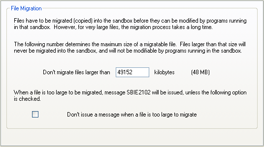

# 文件迁移设置

## Sandboxie Plus

SandMan > 沙盒选项 > 常规选项 > 文件迁移

Sandboxie 通常允许沙盒内的程序读取宿主机上的文件，无需预先复制。当程序请求的操作需要修改已有文件时，Sandboxie 会将文件迁移到沙盒中，并在沙盒副本上执行修改，宿主机上的文件保持不变。

SandMan 的“文件迁移”页面可设置文件大小判断条件，以及优先于该判断的路径规则。

## Sandboxie Control Classic

[Sandboxie Control](SandboxieControl.md) > [沙盒设置](SandboxSettings.md) > 文件迁移：

Sandboxie Control Classic 仍受支持，其“文件迁移”页面可配置 [CopyLimitKb](CopyLimitKb.md)、[CopyLimitSilent](CopyLimitSilent.md) 等已有的迁移大小相关设置。下文介绍的较新迁移规则操作对应当前 SandMan 界面，不代表 Sandboxie Control Classic 中也有相同控件。

## 迁移规则

规则列表支持四种操作：

- **始终复制**（[CopyAlways](CopyAlways.md)）：将匹配的宿主机文件连同内容迁移到沙盒中，不受常规大小限制。
- **不要复制**（[DontCopy](DontCopy.md)）：阻止迁移文件内容。初次迁移时，会移除写入和删除权限后重试打开文件；若启用了 [CopyBlockDenyWrite](CopyBlockDenyWrite.md)，则直接拒绝打开。
- **复制空的副本**（[CopyEmpty](CopyEmpty.md)）：在沙盒中创建长度为零的副本，不迁移宿主机文件的内容。
- **复制较新的版本**（[CopyNewer](CopyNewer.md)）：当匹配的宿主机文件的最后写入时间晚于沙盒副本时，刷新已有的沙盒副本。

前三种操作决定已有普通文件的初次迁移方式。若路径模式同时匹配，优先级为 _DontCopy_、_CopyAlways_、_CopyEmpty_。_CopyNewer_ 则单独检查已有的沙盒副本。它触发刷新时，此次迁移仍使用同一套判断逻辑，因此适用的迁移规则、大小限制、提示行为和相关通知仍可能参与处理。其他规则本身不会触发刷新。

可以配置多条规则，也可以限定规则适用的程序。语法、模式匹配行为及文件打开方式的限制，见各设置项的说明页面。

## 文件大小判断

需要迁移宿主机文件内容、且没有匹配的显式迁移规则时，Sandboxie 会将文件大小与 [CopyLimitKb](CopyLimitKb.md) 比较。文件大小严格小于阈值时，会选择完整内容迁移；设为 `-1` 可取消大小限制。对于达到或超过阈值的文件，SandMan 可根据 [PromptForFileMigration](PromptForFileMigration.md) 提示用户作出选择。同意迁移后会尝试复制，但不保证复制成功。若未获准迁移，[CopyBlockDenyWrite](CopyBlockDenyWrite.md) 决定此次依赖初次迁移的文件打开操作是返回“拒绝访问”，还是移除写入和删除权限后重试打开宿主机文件。重试也可能失败。

如果没有生效的 _CopyLimitKb_ 配置值，运行时默认使用 `-1`。这与 SandMan 界面显示的默认值 80 MiB，以及 Classic 界面和配置读取函数使用的默认值 48 MiB 不同；配置行为详见 [CopyLimitKb](CopyLimitKb.md)。

因大小限制而不迁移文件、且未收到有效的提示答复时，[CopyLimitSilent](CopyLimitSilent.md) 控制是否显示 [SBIE2102](SBIE2102.md) 消息，但不会改变迁移决定。用户明确拒绝迁移时，不会通过此路径产生 SBIE2102。[NotifyNoCopy](NotifyNoCopy.md) 则单独控制显式选择 _CopyEmpty_ 或 _DontCopy_ 模式时产生的 SBIE2113、SBIE2114 和 SBIE2115 消息，包括 _CopyNewer_ 刷新期间的情况。

## 使更改生效

大小限制、静默标志、拒绝写入选项、通知标志及迁移规则列表均在进程初始化时读取。修改后，应重新启动相关沙盒进程。_PromptForFileMigration_ 则不同：重新加载配置后，已运行进程在后续符合条件的迁移判断中也能读取到新值。
